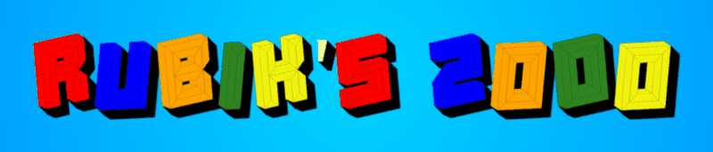

# Rubik's 2000

> *Tired of solving it in 2000 moves? Rubik's 2000 does it in 20.*

A desktop Rubik's Cube solver written in Rust: scan your cube with a webcam,
get an optimal-length solution in seconds, and follow it move by move on an
interactive 3D cube.



## Features

- **Webcam scanning**: each face is detected from the camera feed (square
  detection and color classification). Every sticker can be corrected by hand
  directly on the 3D cube.
- **Fast near-optimal solver**: an implementation of Kociemba's two-phase
  algorithm with precomputed pruning tables. It runs on several threads and
  finds solutions of 20 moves or fewer, within a configurable time limit.
- **Interactive 3D view**: rotate the cube with the mouse, apply moves, shuffle
  it, and preview each move before playing it.
- **Step-by-step playback** of the solution, with play/pause and a timeline.
- **Speedcubing timer** and a built-in help page.
- **Settings**: detection sensitivity, solver timeout and maximum length,
  animation speed.

## Getting started

### Requirements

- Rust (stable) and Cargo
- GTK 3, Cairo, GLib and ATK development headers
- `libv4l` for the webcam
- An OpenGL-capable GPU driver for the 3D rendering

Debian / Ubuntu:

```sh
sudo apt install libglib2.0-dev libcairo2-dev libatk1.0-dev libgtk-3-dev libv4l-dev
```

Arch Linux:

```sh
sudo pacman -S gtk3 v4l-utils
```

### Build and run

```sh
git clone git@github.com:touikss/rubiks-2000.git
cd rubiks-2000
cargo run --release
```

Run it from the repository root: the UI (`res/ui.glade`) is loaded from the
current directory. The solver tables (`tables/`, about 70 MB) are included in
the repository, so there is nothing to generate before the first run.

On Wayland the application forces X11 (XWayland) when it starts. GLFW, which
kiss3d uses for its off-screen render windows, otherwise shows them as
real windows.

## How it works

| Module | Role |
| --- | --- |
| `src/cube` | Cube representations (facelets, cubies, coordinates) and the move and pruning tables of the two-phase algorithm |
| `src/solver` | Multi-threaded search, timeout and solution management |
| `src/imagery` | Webcam image processing: square detection and color classification |
| `src/graphic_cube` | The 3D cube (kiss3d), move animations and facelet picking (ray casting) |
| `src/gui` | GTK views (menu, camera, simulator, solution, timer, help, settings), built from `res/ui.glade` |

The cube is rendered off-screen with kiss3d, then copied into a GTK image after
each frame. When you hover over a facelet, a ray is cast from the cursor into
the 3D scene to find the nearest sticker.

## Authors

Originally a student project (EPITA, 2024), developed between February and April
2024; bug fixes, English documentation and a licence were added in October 2026. Built by:

- Théodore Deguest
- Timothé Le Bronnec
- Arthur Bonnefont
- Hamza Hannat

The project report (in French) is available in [`oral_repport.pdf`](oral_repport.pdf).

## References

**Solver**
- [Kociemba's two-phase algorithm](https://kociemba.org/cube.htm), our main reference
- [A short overview paper](https://www.jetir.org/papers/JETIR1906707.pdf) and a [survey of solving algorithms](https://www.diva-portal.org/smash/get/diva2:816583/FULLTEXT01.pdf)
- [God's Number is 20](http://cube20.org/)
- [Thistlethwaite's algorithm](https://www.jaapsch.net/puzzles/thistle.htm) and [Jaap's puzzle theory pages](https://www.jaapsch.net/puzzles/theory.htm#group)
- [Group theory and the Rubik's Cube](http://trucsmaths.free.fr/rubik_groupe.htm) (French)
- [Thistlethwaite explained in SQL](https://explainextended.com/2022/12/31/happy-new-year-14/) and a [Rust implementation](https://github.com/V-Wong/CubeSimRS)

**Libraries**
- [gtk-rs](https://gtk-rs.org/) for the UI
- [kiss3d](https://docs.rs/kiss3d/latest/kiss3d/) for the 3D rendering
- [rscam](https://docs.rs/rscam/latest/rscam/) for the webcam

## License

[MIT](LICENSE).
